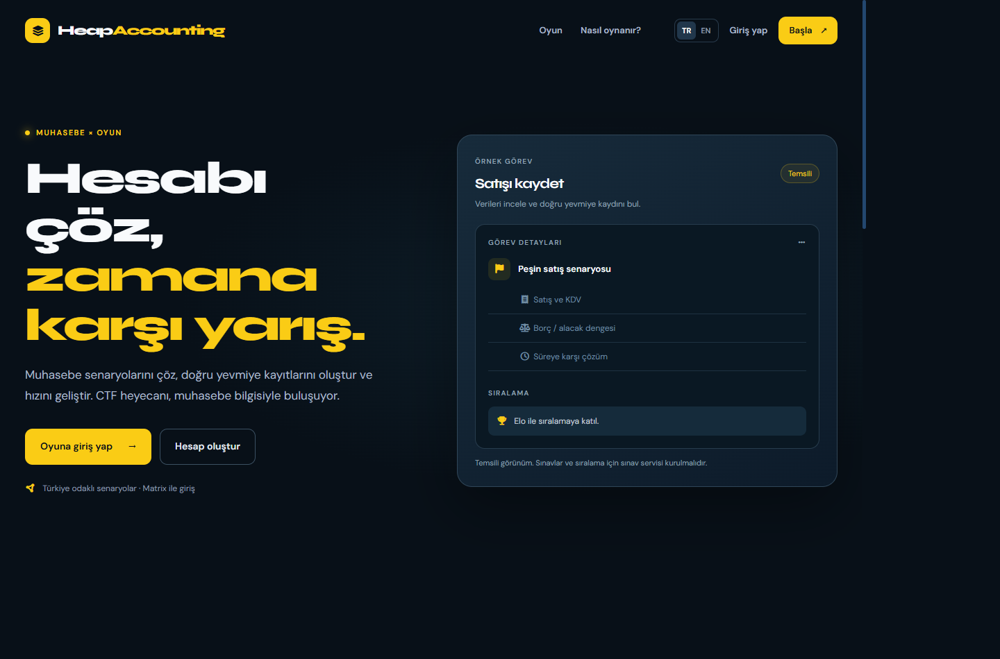
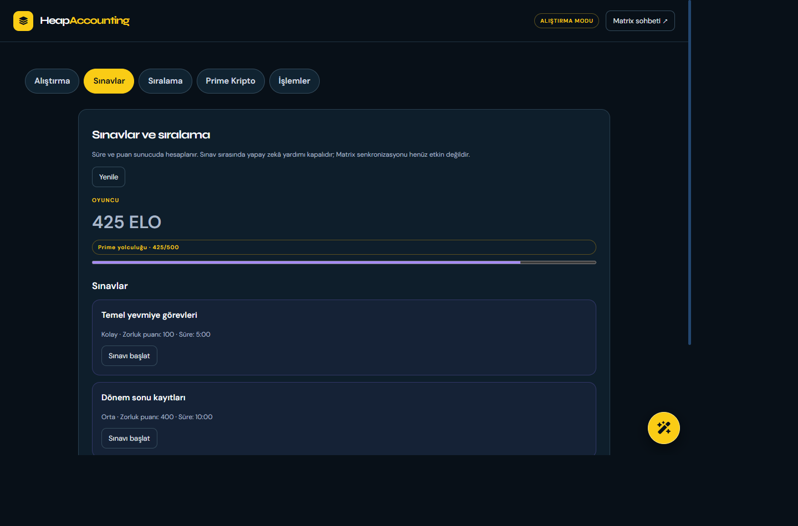
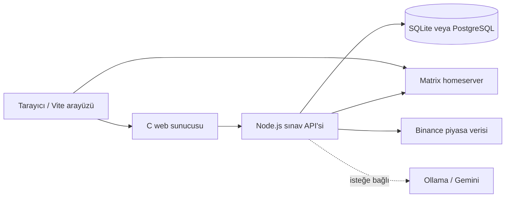

# HeapAccounting

**Muhasebe öğrenimini görevler, sınavlar ve sıralama ile birleştiren eğitim oyunu.**

Oyuncular Matrix hesaplarıyla giriş yapar, muhasebe senaryolarını çözer ve
sunucu tarafından değerlendirilen sınavlarda Elo puanı kazanır. 500 Elo'da
açılan Prime Kripto, gerçek Binance piyasa verilerini kullanan **sanal** bir
işlem simülatörüdür; gerçek emir göndermez.

> Proje geliştirme aşamasındadır. Mesleki danışmanlık, yatırım tavsiyesi veya
> Türkiye mevzuatına uygunluk garantisi değildir. Gerçek finansal ya da kişisel
> verilerinizi yüklemeyin.

## Ekran görüntüleri

| Ana sayfa | Sınavlar |
| --- | --- |
|  |  |

Sınav ekranındaki hesap, puan ve sınavlar gösterim için oluşturulmuş örnek verilerdir.

## Özellikler

- **Alıştırmalar:** Yevmiye kayıtları ve yönetici tarafından oluşturulan zorunlu görevler.
- **Sınavlar:** Türkçe/İngilizce çoktan seçmeli ve yevmiye soruları, süre,
  sunucu tarafında puanlama ve tek deneme.
- **Sıralama:** Alıştırmayı tamamlayan oyuncular 100 Elo ile sıralamaya katılır.
- **Sınav tasarımcısı:** Görsel editör, indirilebilir JSON sınav/soru şablonu
  ve PDF/CSV ekleri. Ek dosyalar otomatik puanlanmaz.
- **Prime Kripto:** Binance USDⓈ-M mark fiyatları, sanal long/short, pozisyonlar,
  kâr/zarar, işlem geçmişi ve ayrı bir TradingView grafiği.
- **Yardım:** İsteğe bağlı Ollama veya Gemini; aktif puanlı sınavlarda kapalıdır.
- **Matrix:** Mevcut hesapla oturum açma ve sohbet.

## Teknoloji yığını

| Katman | Teknoloji |
| --- | --- |
| Web arayüzü | JavaScript, Vite, CSS, Matrix JS SDK |
| Sınav API'si | Node.js 22.15+, HTTP API |
| Veri tabanı | SQLite (`node:sqlite`) veya PostgreSQL |
| Web sunucusu | C, POSIX soketleri, `poll`, ters proxy |
| Hesaplama ve dosyalar | C/WebAssembly, ExcelJS, CSV/JSON |
| Piyasa verisi | Binance WebSocket/REST, TradingView embed |
| İsteğe bağlı AI | Ollama veya Gemini API |
| Dağıtım | Docker Compose, nginx, PostgreSQL |
| Testler | Node.js test runner; PostgreSQL testlerinde PGlite |



Docker kurulumunda nginx, web ve API isteklerini ilgili servislere yönlendirir.

## Hızlı kurulum

### Windows

1. Node.js **22.15 veya üzeri** ve npm kurun. C sunucusu ve WebAssembly derlemesi
   için MSYS2, GCC/make ve Clang/lld gerekir; başlatıcı eksik araçlar için onay ister.
2. Depoyu klonlayın ve proje kökünde çalıştırın:

   ```powershell
   git clone https://github.com/ogulcanunverenpt-star/HeapAccounting.git
   cd HeapAccounting
   .\src\start-all.cmd
   ```

3. İstendiğinde yönetici Matrix kimliğinizi girin (`@kullanici:matrix.org`).
   İlk çalıştırmada `src\exam-service\.env` oluşturulur. Ardından
   [http://localhost:3490](http://localhost:3490) adresini açın.

Farklı bir MSYS2 dizini için `powershell -NoProfile -ExecutionPolicy Bypass
-File .\src\start-all.ps1 -Msys2Root C:\msys64` kullanın. MSYS2 DLL hatalarında
sunucuyu doğrudan çalıştırmak yerine başlatıcıyı kullanın.

### Linux

Node.js 22.15+, npm, C derleyicisi/make, Clang ve lld gereklidir. Ardından:

```sh
git clone https://github.com/ogulcanunverenpt-star/HeapAccounting.git
cd HeapAccounting
sh src/start-all.sh
```

Yönetici Matrix kimliğini girin ve [http://localhost:3490](http://localhost:3490)
adresini açın. Terminali açık tutun; `Ctrl+C` servisleri durdurur.

### Docker Compose

Docker Desktop veya Docker Engine ve Compose kurulu ve çalışır durumda olmalıdır.
Windows'ta `src\start-docker.cmd`, Linux'ta `sh src/start-docker.sh` çalıştırın.
Başlatıcı Matrix homeserver URL'si, yönetici kimliği ve PostgreSQL parolasını
sorar. Başlatmadan önce onay alır.

Uygulama [http://localhost:8080](http://localhost:8080) adresinde açılır.
Mevcut PostgreSQL volume'ünü kullanırken aynı parolayı kullanın. Docker
kurulumu yerel `DB_DRIVER` seçimine bakmadan PostgreSQL kullanır.

## Yapılandırma

Yerel başlatıcı, mevcut dosyayı değiştirmeden
[`src/exam-service/.env.example`](src/exam-service/.env.example) şablonundan
`.env` oluşturur. Önemli ayarlar:

| Değişken | Açıklama |
| --- | --- |
| `DB_DRIVER` | `sqlite` veya `postgres` |
| `SQLITE_PATH` | SQLite dosyası; varsayılan `data/exams.sqlite` |
| `DATABASE_URL` | PostgreSQL bağlantısı; alternatif olarak `PGHOST`, `PGUSER`, `PGDATABASE`, `PGPASSWORD` |
| `MATRIX_URL` | Kimlik doğrulanacak homeserver URL'si |
| `EXAM_ADMIN_IDS` | Sınav yayımlayabilen Matrix kullanıcı kimlikleri |
| `HOST`, `PORT` | Sınav servisi dinleme adresi ve portu; varsayılan `127.0.0.1:3491` |
| `AI_PROVIDER` | `disabled`, `ollama` veya `gemini` |
| `AI_MODEL`, `OLLAMA_URL`, `GEMINI_API_KEY` | Seçilen AI sağlayıcısının ayarları |

`.env`, API anahtarları, oturum bilgileri ve veri tabanı dosyalarını Git'e
eklemeyin. Gerçek Matrix homeserver ve bağımsız PostgreSQL üzerinde doğrulama,
güvenlik incelemesi ve üretim HTTPS yapılandırması ayrıca gereklidir.

## Sınav hazırlama

Yönetici hesabıyla **Sınavlar → Sınav yayımla** bölümüne gidin. Görsel
tasarımcıdan soruları oluşturabilir veya örnek JSON tanımını indirip
düzenledikten sonra yükleyebilirsiniz. Puanlanan sorular ve cevap anahtarları
tanımda bulunur. PDF/CSV ekleri sınav sırasında katılımcılara sunulur; cevap
anahtarını ek dosyalara koymayın. Örnek CSV şablonu da arayüzden indirilebilir.

## Test ve geliştirme

```powershell
cd src\serverroot
$env:WASM_CC = 'C:\msys64\ucrt64\bin\clang.exe' # Clang PATH üzerinde değilse
npm ci
npm test
npm run build

cd ..\exam-service
npm ci
npm test
```

Linux'ta `WASM_CC` yalnızca Clang PATH üzerinde değilse gereklidir; yolları
`src/serverroot` ve `src/exam-service` olarak kullanın. C sunucusunun ek
testleri için `src` dizininde `make server-test` çalıştırılabilir.

## Önemli sınırlamalar

- Sınav, sonuç ve işlem verileri veri tabanındadır; Matrix odalarına senkronizasyon
  ve Matrix AI botu henüz uygulanmamıştır.
- Prime Kripto gerçek işlem yapmaz. İşlemler ve Matrix kullanıcı kimliği diğer
  oyunculara görünür. Tasfiye yalnızca sunucunun gözlemlediği fiyatlarla
  simüle edilir; kesintilerdeki hareketler kaçabilir.
- İşlemler için güncel Binance mark fiyatı ve USDT/TRY kuru gerekir. Sistem
  saati senkronize değilse fiyatlar güvenlik nedeniyle reddedilir. TradingView
  grafiği yürütme fiyatı kaynağı değildir.
- BIST simülatörü mevcut değildir. Gerçek Matrix, bağımsız PostgreSQL, Docker ve
  canlı Binance işlem akışının tamamı bu ortamda doğrulanmamıştır.

Ayrıntılı kurallar, API ve sınırlamalar için
[sınav servisi belgelerine](src/exam-service/README.md) bakın.

## Kaynak ve lisans

Mevcut depo lisansı [LICENSE](LICENSE) dosyasındadır. Matrix istemcisinin
başlangıcı [Trinity](https://github.com/KohanMathers/Trinity) projesine dayanır;
üçüncü taraf bileşenlerin kendi lisansları ayrıca geçerlidir.
